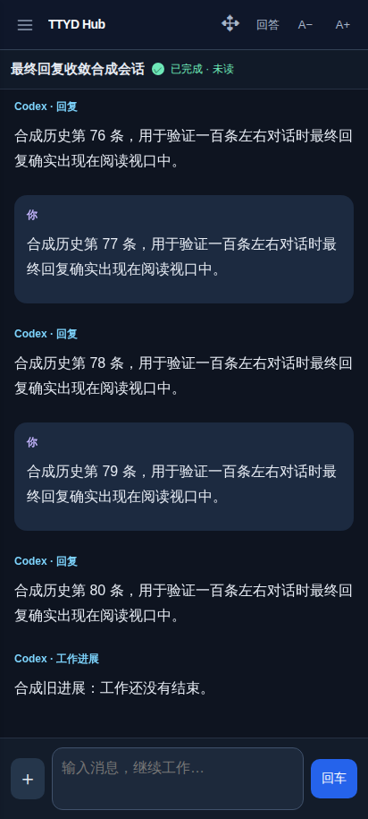
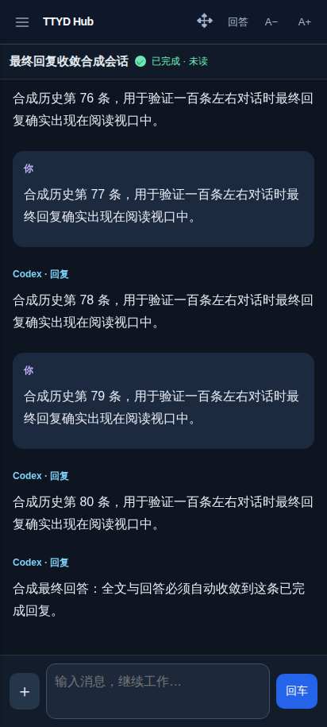

# 首次打开时最终回复未自动显示：复核与修复（2026-10-25）

问题验收以用户看到的结果为准：全文已经有最终回复时，重新打开后的回答必须自行追上；不能依赖输入、点击切换或获得焦点。已有可读文字、完成绿灯、DOM 中存在最终文字，都不能单独证明通过。本次保持原来的回答／全文单按钮和布局。

## 复现与消除变量

以下实验使用正式构建与独立合成会话。先在测试进程读取全文，确认最终回复已存在，再打开手机回答页。除单独测试实际已读的场景外，浏览器禁止获得读取焦点，记录全部 API 写入；不点击、不发送终端输入。旧代码分别复现失败后才保留对应回归。

| 已确认的问题 | 原因与修复 |
| --- | --- |
| 一次读取挂起后，定时核对永远不能恢复；新输入后才恢复 | 原请求只调用 `AbortController.abort()`，没有保证 fetch 或 JSON body 真正结束。增加共享的取消竞争，截止时主动拒绝并释放在途任务。正文、列表、共享同步、发送确认、追问和额度读取均覆盖响应头与正文。只读核对可重试；发送结果未确认仍保留草稿，不自动重发。 |
| 缓存有旧进展就转入慢速核对 | “已有文字”不代表已追上当前正文。只要实际展示的完成轮次或正文版本落后，就继续快速核对；版本相符后才回到完成会话的常规间隔。 |
| 任务完成后最终正文才写入，同一完成轮次不再通知 | 完成状态与正文版本独立。发布消息、接收记录、完成标记和正文 SHA256 为同一不可变快照；正文变化也发布通知。HTTP 与持久缓存保存相同版本，不能用新状态给旧正文盖章。 |
| 文件末尾已有完整最终 JSON，却要等下一次换行 | EOF 的完整 JSON 立即解析并按字节推进；半条 JSON、拆开的 UTF-8 继续等待。后续 CRLF 不重复提取。 |
| 同轮次旧进展已读，迟到的最终回复不再提醒 | 新客户端的已读操作带实际显示的正文版本；服务端拒绝过期版本。同轮次新正文重新成为未读，实际渲染后才能确认并同步。旧持久标记和旧客户端保持兼容，不批量重置历史已读；只有实际看过并核对版本后才静默补绑定，不改已有手动排列。电脑原生终端也核对捕获和渲染的版本。 |
| 最终文字已在 DOM，缩窗后却在屏幕下方 | 80 条历史实验确认：窗口从 915 缩到 440 像素，最终回复完全落在阅读视口下方，前台恢复的未变化响应不能纠正位置，发送时滚到底部才显现。阅读区布局变化时保留“跟随最新”的意图并校正到底部；主动翻看旧历史时继续保留位置。已读另核对实际底部几何位置。 |

## 自动化证据

- `tests/mobile-answer-convergence-browser.cjs`：旧轮次、保留的旧结构回答、同轮次旧版本、最终正文晚到（通知／仅 HTTP）、fetch 挂起、JSON 挂起、旧正文不得已读、长历史缩窗跟随与主动翻历史。除专门的已读确认外，全程零 API 写入、零终端输入；检查实际展示的版本、最终消息 ID 和阅读视口几何位置。请求挂起实验将 15 秒截止缩短为 300 毫秒，其他轮询间隔不改。
- `tests/session-read-revision-browser.cjs`：后台 r1 已读后，迟到 r2 自动变绿；明确打开后，仍在显示的 r1 不得清除提醒；r2 自行追上后只确认一次，重开保留。选择查看属于该独立已读实验，不作为首屏自动收敛的证据。
- `tests/session-content-deadline.test.js`、`tests/session-request-deadline.test.js`：忽略 AbortSignal 的响应头、正文与替换请求必须结束，普通定时核对可恢复。
- `tests/dialog-request-deadline-browser.cjs`、`tests/mobile-input-browser.cjs`：追问／额度不会永久卡住；发送结果未确认后保留草稿且不自动重复提交。
- `tests/content-revision.test.js`、`tests/session-sync-revision.test.js`、`tests/codex-activity.test.js`：晚到正文、快照一致性、同名会话替换、EOF 与不完整字节、版本拒绝、持久化回滚及旧协议兼容。
- `tests/terminal-read-browser.cjs`、`tests/terminal-cache.test.js`：电脑终端的旧画面不能确认同轮次新版本，快照差异保留版本信息。

合成截图仅含测试内容：

| 初始旧进展 | 无输入自动追上最终回复 |
| --- | --- |
|  |  |

## 发布与验证边界

本机 `npm test` 共 203 项：202 通过，1 项 Windows ConPTY 真环境检查跳过。最终构建的 10 组收敛实验、独立已读版本实验、20 组状态、5 组展示、输入确认、手机／电脑元数据重开、多端同步、电脑终端已读及四种手机前台恢复实验均通过。新浏览器回归已加入 Linux／Windows CI。

发布后的本机生产入口另做只读浏览器检查：412px、真实 81 条历史，先种入缺少最终回复的旧本地缓存，关闭通知通道并禁止全部非 GET 请求和读取焦点。正常网络约 661 毫秒呈现完整最终回复；首个 fetch 永不结束且忽略 AbortSignal 时，使用未缩短的 15 秒截止，约 16,694 毫秒自动重试并呈现最终回复。两次均比较完整渲染正文、实际显示的版本及最终回复末尾在视口内，API 写入和终端输入均为零。没有将私人正文或截图写入公开报告；这些时间是本次观察，不是所有网络或设备的速度承诺。部署保留 8 个会话与全部原 tmux PID，公网页面／API 与规划 Lab 共享文件的匿名访问仍为 401，导航 412／1440px 的入口和预览均正常。

沿用 `npm run deploy:web` 发布服务与 Android 在线界面，保留 tmux 任务 PID、站点认证及本地数据。网页刷新或 APP 菜单“重新加载”后取得新脚本；APP 的“返回桌面”保留原页面，不能据此保证旧脚本已替换。本次没有修改原生能力，无需重新下载安装 APK。

服务端不可达时无法取得新回复，持久缓存只保证已有正文仍可阅读。未连接 M153；浏览器自动化、Linux／Windows 逻辑测试不等于该手机或 Windows ConPTY 的真机验证。上一轮只验证接口能返回、视图能切换，未覆盖本次正文版本与实际视口的组合，不能用上一轮的结果替代此次验收。
