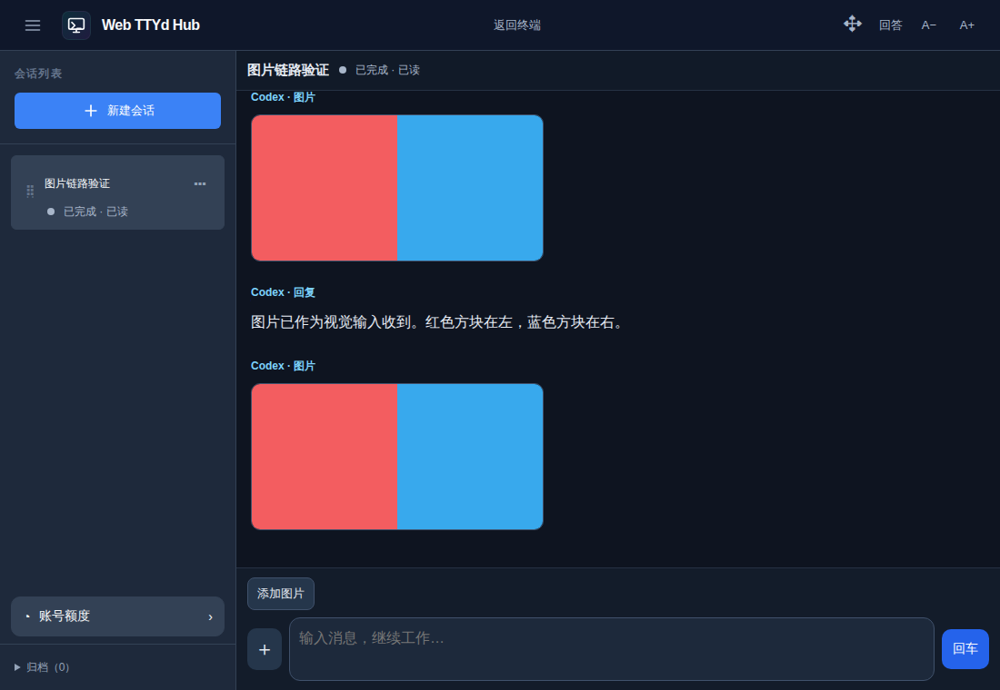

# 图片上传与聊天记录预览

手机在输入框上方点「添加图片」，选图、填写说明后发送；电脑终端支持按钮选图和 Ctrl+V / Cmd+V 粘贴截图，上传后点「加入终端输入区」，再在 Codex 输入区填写说明并提交。图片不会经过服务器的 X11 剪贴板。支持 PNG、JPEG、WebP、GIF，每张最大 20 MB，每次最多 8 张。普通 shell 不显示附件入口。

手机「回答」视图直接显示图片；电脑点顶部「聊天记录」进入同一阅读界面，点「返回终端」恢复交互终端。上传的图片、Codex `view_image` 查看结果及生成图片的明确记录会显示真实缩略图，点击可放大。刷新后从服务器记录重新读取，不要求再发消息。仅在模型文字中提及文件名不会自动开放该文件，也不会自动抓取外部图片网址。

图片保存在服务器私有 `data/images/`（可用 `HUB_IMAGE_DIR` 指定），与终端代次隔离；浏览器只能使用当前会话的图片 ID，不能请求任意本机路径。图片接口继承 Hub 的认证，不发布到 APK 下载区或规划 Lab。图片以独立资源读取，聊天 JSON 和本地消息缓存只保留图片 ID。删除终端不会同时删除 Codex 引用的原附件，避免破坏历史；这次没有改动原 rollout 文件或其清理策略。历史中只有本地路径而没有内嵌图片的数据，仍需要原图片文件存在，才能首次提取预览。

## 终端协议与实际边界

- 本机 Codex 0.166.0，xterm.js 6.0.0 + `@xterm/addon-image` 0.9.0，启用 Sixel。
- 实测 Sixel 字节通过真实 PTY → tmux 3.4 control mode → Hub WebSocket → xterm，画布红蓝像素正确，不产生额外输入或重复设备响应。
- **这不等于 Codex 自己的全屏预览在 tmux 下可用。** 官方 [0.164 更新说明](https://learn.chatgpt.com/docs/changelog)要求全屏聊天记录及 Kitty/Sixel 支持；0.166 的 `codex-rs/tui/src/pets/image_protocol.rs` 检测到 tmux 时仍返回不支持，聊天记录预览也复用该协议选择。Hub 没有伪造终端身份、修改 Codex 或重启现有会话。
- 用户查看图片使用 Hub 的「聊天记录／回答」界面。普通终端的 Sixel 是附加的实际协议支持；tmux 的纯文本快照不恢复历史 Sixel 图像，不把这种能力冒充永久图片记录。未宣称 Kitty 支持。
- Windows 的终端由独立 ConPTY worker 渲染，本次 Sixel 验证范围为 Linux；电脑聊天记录入口和选图接口共用网页功能。

## Android 1.6.0

原有外壳没有 `onShowFileChooser`，因此此次需要覆盖安装一次 1.6.0，沿用原包名和签名，versionCode 8。系统选图器只返回用户选择的图片，不申请全盘存储权限；取消选择或切换服务器时结束旧回调。后续网页逻辑仍通过现有在线发布更新。

[安装新版 APK](http://42.192.115.30:8182/downloads/ttyd-hub/ttyd-hub-latest.apk)。网页版无需 APK；旧 APP 可以继续看图片，系统选图需要新外壳。

## 验证

- `node --test tests/images.test.js`：会话/代次隔离、拒绝非图片和任意文件路径、用户图片/查看/生成事件投影、私有路径标记去除。
- `node tests/images-codex-integration.cjs`：隔离 Codex 0.166 + 私有 tmux + 本地合成模型；真实上传并确认模型请求收到 `input_image`，执行真实 `view_image`，手机/电脑预览、刷新、放大、发送回执、系统剪贴板 Ctrl+V 加入当前 Codex 输入区。
- 生成图片预览通过符合 0.166 格式的 `image_generation_end` 合成记录验证，没有调用付费图片生成服务；与真实 `view_image` 测试区分。
- `node tests/images-terminal-browser.cjs`：通过生产终端链路验证实际画布像素，不仅检查插件加载。
- 回归：文字与 IME 输入、方向键、手机回答状态、慢速读取与完成状态、桌面滚动/复制/重连/多观察者、已读版本检查。
- Android Release 编译、Lint 和签名一致性检查。没有连接 M153 真机，尚未验证真机选图器与 WebView 上传。

真实测试页面（仅合成图片和文字）：

