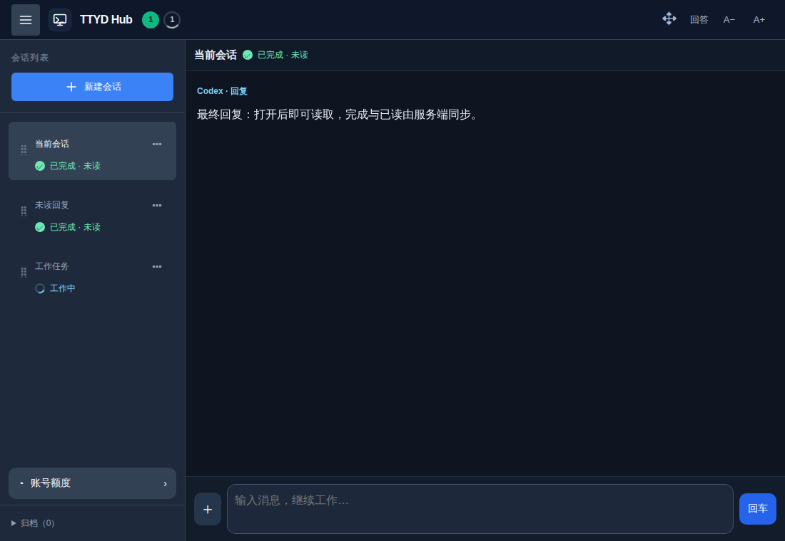

# 重开后任务状态与慢速正文：消融实验（2026-10-30）

本次只修改两个前端触发点。服务端继续统一维护任务状态、已读和排列；不调整大记录解析、不增加恢复机制、不修改原生 APP。

## 控制变量

`tests/state-refresh-ablation-browser.cjs` 使用正式 Vue 构建、隔离 HTTP/WebSocket 服务和合成会话。禁止 IndexedDB，使用全新的浏览器上下文，禁止读取焦点，记录所有 HTTP 写入；不发送消息、不触发前台／联网事件。

1. **状态实验：**先显示一个其他未读会话与一个其他工作会话。只让 HTTP 列表返回 503，保留 WebSocket 连接，等待原有五秒核对。观察期间没有新通知替计数解锁。随后在服务端模拟另一设备的已读，验证共享广播仍生效。
2. **正文实验：**正文固定延迟 1.8 秒，服务端连续 3 秒每 250 毫秒发布阶段与正文版本变化。持续变化期间必须显示已取得的进展；随后发布成功完成，最终回复须在一秒内显示，且展示版本正确。所有 API 写入为零。

修改前与三个修改组合分别独立构建；实验路由、通知和延迟保持相同。

| 正式前端构建 | 状态实验 | 正文实验 |
| --- | --- | --- |
| 原实现 | 失败：未读、工作计数消失 | 失败：持续通知期间没有正文 |
| 只修改状态判断 | 通过 | 失败 |
| 只修改正文读取 | 失败 | 通过 |
| 同时保留两项修改 | 通过 | 通过 |

只修改正文和最终组合都发起三次正文读取：连续进展复用在途读取，成功完成立即取得最终回复。实验不依赖本地正文缓存，两项缺陷各由一项修改消除。

实际页面预览使用合成内容，捕获于 HTTP 列表失败且通知连接保持打开期间：

## 最小修改

- 列表读取失败时，通知连接若仍打开，不设置全局断线标志。两条通道都不可用时沿用原断线提示与已有重试流程。
- 阶段／版本进展通知不再强制取消在途正文读取。新的成功完成标记继续替换旧进展请求。沿用原超时、前台处理、视图切换和已读校验。

没有增加连接健康检测、自动刷新页面、额外轮询或新的状态存储。保留现有缓存、任务状态语义与手机布局。

## 验证与发布

`npm test`：204 项，203 通过，1 项 Windows ConPTY 真环境测试跳过。专项浏览器测试已加入 Linux／Windows CI。另核对最终回复收敛、手机前台恢复、跨端已读与状态展示；具体自动化结果以该提交的 CI 为准。

沿用 `npm run deploy:web` 发布网页与 APP 在线界面，核对已有 tmux 窗格 PID。APP 菜单“重新加载”或结束应用进程后重开取得新脚本；普通返回桌面会保留原页面。无需新 APK。未连接 M153，浏览器实验不代表真机验证。
