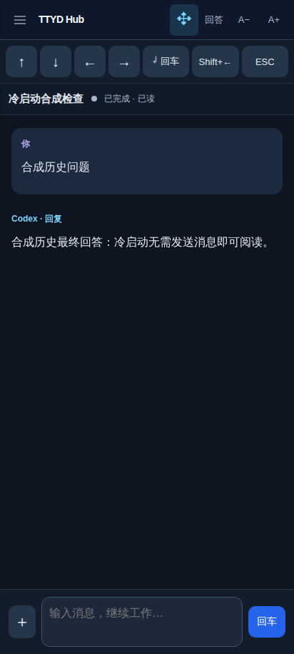
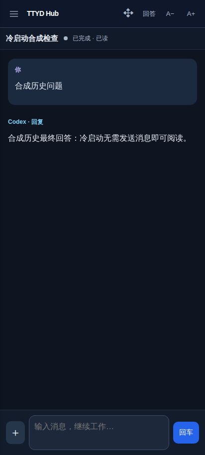
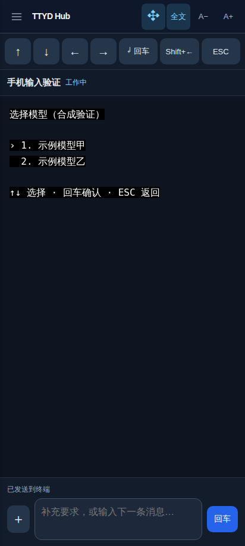
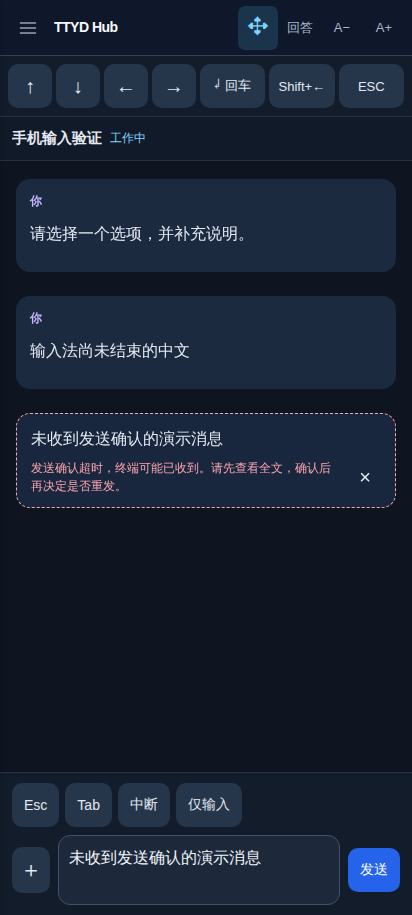
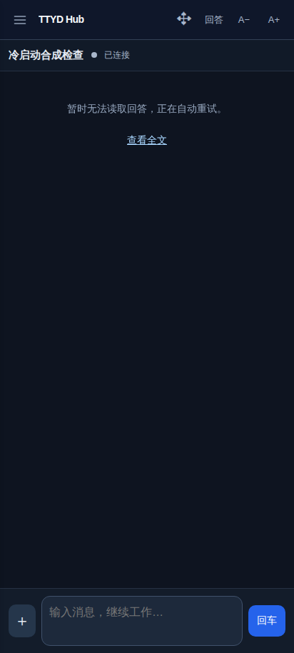
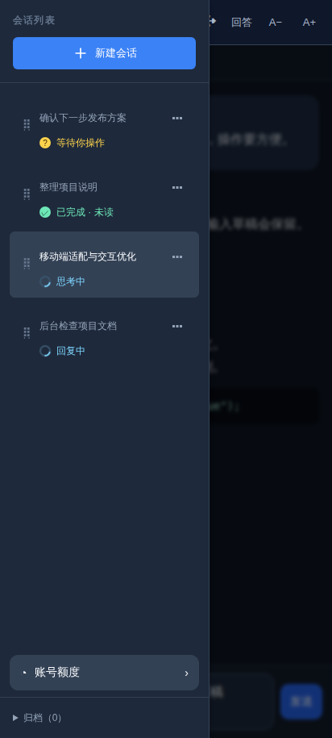
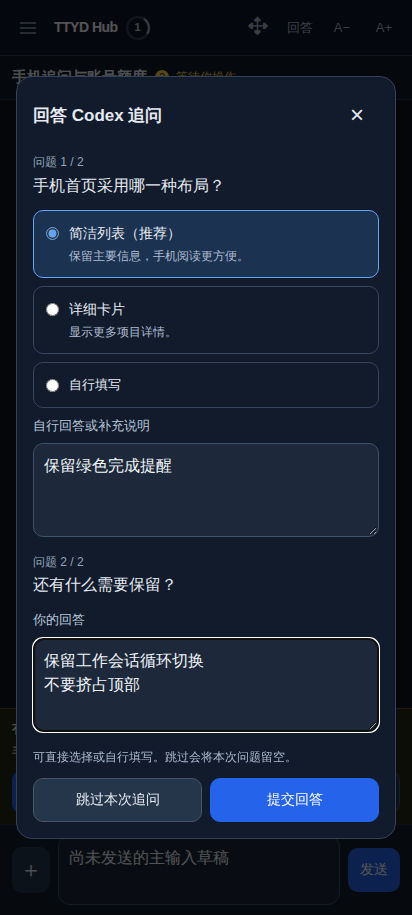
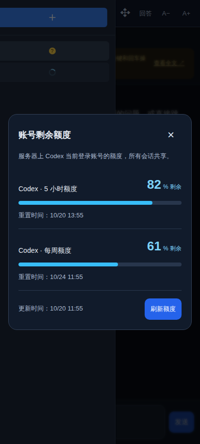
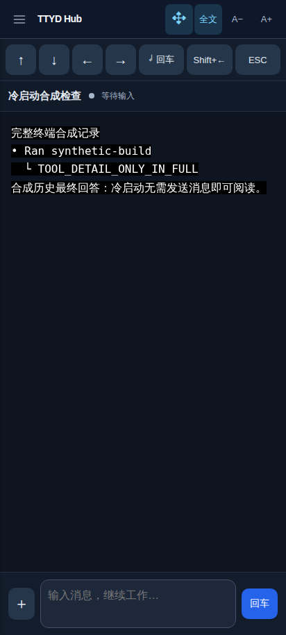

# TTYD Hub 手机操作与恢复检查 · 2026-10-20

目标：打开已有会话后直接阅读历史回答、查看完成状态和切换全文；操作 `/model` 等终端命令时可以用方向键和回车完成操作，不要求额外发送消息来恢复界面。

本次检查采用 `product-design:audit` 的先截图、逐步操作和核对反馈流程。下面公开截图均来自本次运行的合成会话，没有真实聊天、账号或凭据。

## 查阅的方法及本次应用

| 原始文档 | 应用方式 |
| --- | --- |
| [Nielsen Norman Group：10 项可用性原则](https://www.nngroup.com/articles/ten-usability-heuristics/) | 逐项核对状态反馈、控制结果、命令与提问的区别、退出和恢复入口，删除重复提示。 |
| [ISTQB Test Analyst v4：状态转换、场景和探索测试](https://istqb.org/wp-content/uploads/sdm-uploads/ISTQB-CTAL-TA-Syllabus-v4.0-EN.pdf) | 把冷启动、读取中、可阅读、来源暂不可用、发送中、结果未确认列为独立状态；测试连续切换与恢复，使用真实用户流程补查单项测试的空隙。 |
| [W3C：状态消息](https://www.w3.org/WAI/WCAG22/Understanding/status-messages.html) | 区分终端已收到与 AI 已接收，状态提示使用适当语义，不用永久等待消息表示本地命令。 |
| [W3C：键盘操作](https://www.w3.org/WAI/WCAG22/Understanding/keyboard.html) | 会话选择须能获得焦点并用回车打开；终端命令验证方向键、回车、ESC。 |
| [W3C：触摸目标](https://www.w3.org/WAI/WCAG22/Understanding/target-size-minimum.html)、[焦点不被遮挡](https://www.w3.org/WAI/WCAG22/Understanding/focus-not-obscured-minimum.html) | 检查 320／412 CSS 像素界面、缩小后的键盘视口、控制可点击区域和焦点可见性。 |

可用性原则用于决定期待的行为，状态转换和控制变量实验用于检验实现。截图只能支持可见行为，不能单独证明完整的无障碍合规。

## 操作步骤与结果

| 步骤 | 操作及状态 | 结果与证据 |
| --- | --- | --- |
| 1 | 冷启动，空缓存／旧全文缓存，完全不发送消息 | 已修复：回答区域不再冒充全文；后台自动恢复历史。截图 01、02。 |
| 2 | 初始化期间及恢复后反复切换回答／全文 | 通过：全文随时可访问；回答排除工具日志，最终回复完整保留。截图 02、03。 |
| 3 | 先在后台启动，再回到前台；来源较长时间不可用 | 通过：自动继续读取，保留已取得的回复；不把旧内容算作新一轮已读。截图 04、07。 |
| 4 | `/status`、`/model`、`/resume`、`/new`、仅输入 `/` | 已修复：进入终端与方向键操作，不等待一个不会产生的 AI 消息回执。截图 05。 |
| 5 | 普通提问、中文输入法、追问回答、重复输入 | 通过：普通消息仍须匹配自己的接收记录；命令、文件路径与提问分别处理。 |
| 6 | 发送响应头或正文挂起 | 已修复：10 秒后解除输入锁定，保留草稿、不自动重发；读取刷新不清除发送结果未确认的信息。截图 06。 |
| 7 | 切换、重建同名会话、置顶／排序、归档恢复、双端已读与断线恢复 | 已修复同名会话的选择、旧草稿及排队输入沿用；点击当前会话也会关闭手机列表。其余通过现有生命周期与双端实验。截图 08、11。 |
| 8 | 会话键盘选择、小屏幕、软键盘高度、菜单、额度与追问表单 | 已修复键盘无法直接打开会话；320／412 像素、菜单和表单回归通过。截图 08、09、10。 |
| 9 | 电脑终端滚动、复制粘贴、重连、独立查看及后台进程保留 | 通过真实隔离终端测试；没有向生产会话发送测试输入。 |

## 主要发现及修复依据

- 冷启动时，回答接口第一次观察还没取得来源就返回了终端快照。前端又把快照放进回答区域，导致两种模式看起来完全相同。修改前的浏览器断言直接发现回答中出现工具日志；修改后，在正文内显示读取状态，初始化完成后自动显示已有最终回答。
- 首次回答读取共用最多 4 秒的后台初始化等待，全文不等待。真实 Codex 0.163.0 的隔离恢复测得约 3.05 秒和 4.56 秒；较慢时允许第一次读取超时，之后仍由正常后台观察和前端重试恢复，没有新模型输入。4 秒是等待上限，不是所有设备的启动速度承诺。
- 本地斜杠命令不会产生普通用户对话记录，原来的接收匹配会永久等待。真实 Codex 与生产 `SessionManager.input/history` 的 tmux 粘贴链路验证了命令、菜单和按键操作，无模型调用。
- 发送请求没有确认期限，网络响应停住时会把所有终端按键一直锁住；后台读取还会清除发送错误。修改前超过 12 秒仍不能继续操作，修改后确认期限覆盖响应头和 JSON 正文，并保留结果未确认的信息。
- 会话列表只按名称保留当前选择，重建同名会话可能沿用上一会话的选择和输入资料；选择与临时输入现在核对创建时间。Linux／Windows 输入队列也在执行前和延迟步骤后核对原会话，旧排队请求不能向替代会话发送内容或回车。
- 会话列表原来只依赖点击容器，缺少直接键盘打开的入口。名称现在具有真实按钮语义和可见焦点，样式沿用原布局。
- 手机列表展开后再次选择当前会话，不会触发“当前名称改变”的监听，原来因此不能关闭列表。现由选择操作直接关闭，修改前明确复现列表仍展开，修改后触摸和键盘选择均验证。

## 持续验证

常规回归：`npm test`、`npm run build`，以及以下浏览器脚本：

```sh
node tests/mobile-cold-start-browser.cjs
node tests/mobile-state-browser.cjs
node tests/mobile-input-browser.cjs
node tests/activity-browser.cjs
node tests/session-sync-browser.cjs
node tests/codex-picker-browser.cjs
node tests/codex-mobile-browser.cjs
npm run test:terminal
```

Linux 上安装 Codex 0.163.0 后可运行真实程序的隔离回归，使用临时目录、本地合成模型和独立 tmux，不读取生产凭据：

```sh
node tests/codex-cold-start-integration.cjs
node tests/mobile-command-integration.cjs
node tests/codex-questions-integration.cjs
```

GitHub 的 Linux／Windows 检查加入了冷启动浏览器回归；Linux 另外运行真实 Codex 冷启动和命令链路。浏览器中模拟 Windows API／基础路径不等同于已验证家庭 Windows 主机的实际运行状态。本次没有连接 M153 手机，不把浏览器与隔离程序检查写成手机真机验证。

## 本次截图

1. 初始化中的回答，只在正文显示读取状态。

   

2. 不发消息，历史最终回答自动恢复。

   

3. 全文保留终端工具记录。

   

4. 从后台返回后继续读取。

   

5. 斜杠命令与方向键操作。

   

6. 发送确认超时后的草稿及操作恢复。

   

7. 来源暂不可用时自动重试，全文仍可打开。

   

8. 会话状态、列表与键盘选择。

   

9. 追问操作。

   

10. 额度表单。

   

11. 同名替代会话的输入资料保持空白。

    
