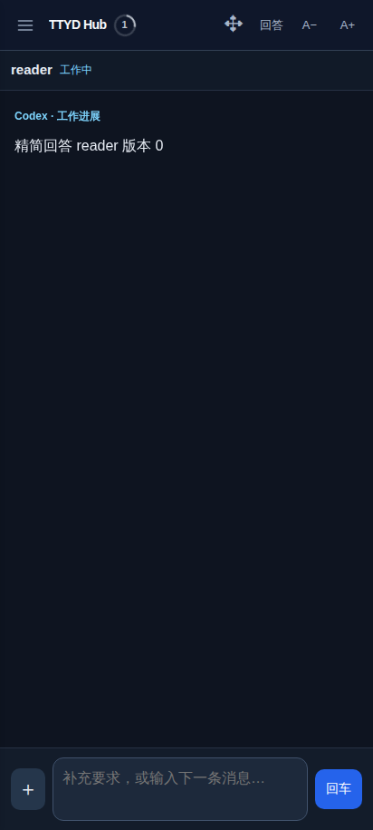
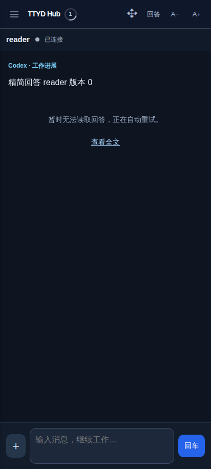
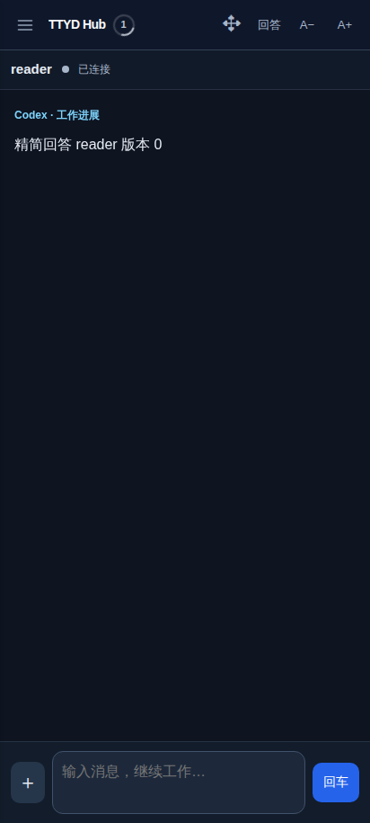
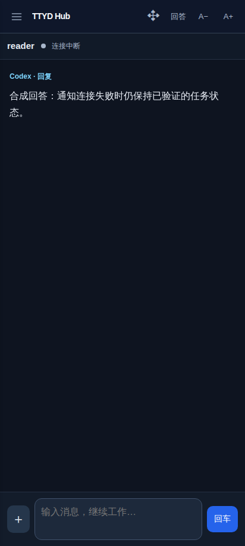
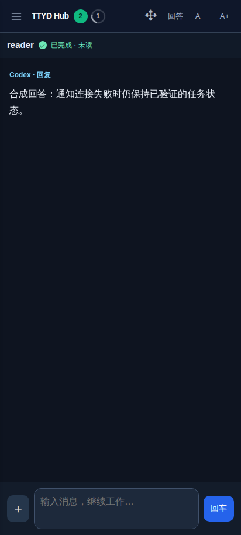
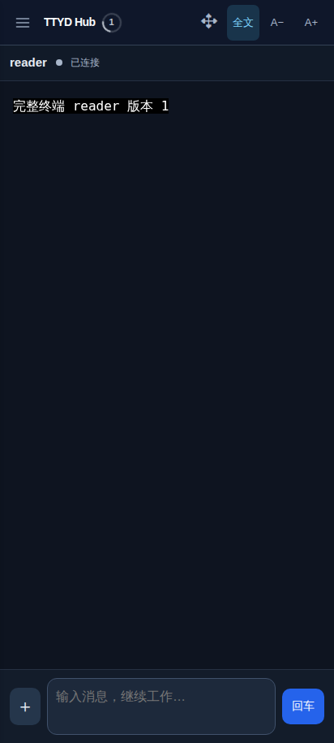

# 手机启动、回答提示与会话状态复核（2026-10-24）

本轮复核针对「回答完整但显示读取失败」「打开时没有绿色未读，发消息后才出现」，范围包括首屏、回答／全文、通知连接、来源暂缺、持久缓存、已读、置顶及排序。保留原来的按钮和布局。界面截图全部来自本轮正式 Vue 产物与合成会话，不含用户会话；生产仅执行只读检查，没有输入、调整终端尺寸或标记已读。截图已逐张打开检查。

## 界面流程与证据

1. **打开会话：正常基线。** 回答、当前状态和输入区能直接显示。通知建立失败的情况单独检查，不能以通知正常时的首屏代替。

   

2. **来源暂缺，已取得的回答仍可读：旧版误报，修复后通过。** 旧版的消息列表使用已提取的结构缓存，失败提示却只看最新响应是否有 `messages`，同一画面同时出现回答与「暂时无法读取回答」。旧测试甚至要求该提示出现，已纠正。现在以实际展示的对话判断是否需要占位；HTTP 200 的来源未就绪不再仅因经过十秒就被当作读取失败。

   | 修改前 | 修改后 |
   | --- | --- |
   |  |  |

3. **HTTP 正常、通知升级持续返回 401：旧版计数消失，修复后通过。** 旧版 `ws.onclose` 无条件把全局状态设为中断，抹掉 HTTP 已确认的两个未读和一个工作任务；重连打开还会反复取消慢列表请求。现在通知与普通读取分别恢复，通知断开不否定有效的 HTTP 状态；真正列表失败仍会降级。修改前后使用同样的失败通知服务，计数检查跨过多次重连和常规核对周期，未点击或输入。

   | 修改前 | 修改后 |
   | --- | --- |
   |  |  |

4. **切换全文再返回回答：通过。** 沿用单个切换按钮，全文保留执行输出，回答保留结构对话；来源暂缺不接管按钮，不把执行日志混作结构回答。

   | 修改前的全文 | 修改后的全文 |
   | --- | --- |
   |  |  |

## 同时查出的缓存与展示问题

| 问题 | 修复与验证 |
| --- | --- |
| 磁盘结构回答迟到，先返回的全文兜底覆盖它 | 答案缓存增加独立的 `retainedAnswer`，保留已验证对话；最新正文、ETag 和完成标记不回退。250 ms 磁盘晚于网络时仍能显示旧对话；新结构数据（含空数组）清理旧备份。备份计入原容量限制。 |
| HTTP 已确认已读／置顶，但快速关闭保存旧元数据 | 共享同步每次接受权威结果即更新持久快照；乐观操作不冒充确认，较旧 revision 不回滚。 |
| 缓存列表可见、首次权威列表未到达时的置顶／排序被覆盖 | 操作进入既有 outbox，重载先恢复预览，联网核对创建标识后合并；同名新会话不能继承旧操作。 |
| 消息正文和 ID 未变，进展转最终回复后仍显示旧标题 | 渲染复用同时检查 phase。 |
| 保留旧 t1 回答时，最新全文兜底带 t2 | 已读校验绑定实际展示对话的完成标记，旧 t1 不能确认 t2；真正显示 t2 后仅确认一次。 |

这些是代码、HTTP、IndexedDB 与同步状态的自动化证据，不是从截图推断出的持久化结论。

## 检查结果与边界

- `npm test`：170 项，169 通过，1 项仅 Windows ConPTY 真环境可运行而跳过。
- 新 `session-transport-browser.cjs`：真实 WebSocket Upgrade 反复 401，两个未读与一个工作计数稳定，零 API 写入、零终端输入。
- 新 `mobile-answer-presentation-browser.cjs`：可读缓存、成功全文兜底、真正 HTTP 500 及恢复、阶段标签变化、t1／t2 已读隔离均通过，零终端输入。
- 新 `session-answer-cache.test.js`、`session-confirmed-cache.test.js`、`session-offline-layout.test.js`：迟到磁盘、重开、304、空对话、创建标识隔离、确认落盘、未确认预览及联网合并通过。
- 原有 20 组状态实验、5 组冷启动、手机／电脑元数据、多端已读和排列、手机本地缓存、正文差异校验及损坏恢复通过。输入回归仅对合成会话操作，不触碰生产终端。
- 线上后端只读检查：8 个会话均能独立识别；首次回答、全文均正常返回。ETag 覆盖正文形状与完成标记，未发现此次需要改动后端或 APK 外壳的证据。

可访问性风险：错误的 `role="status"` 提示会让辅助技术宣读与可见回答矛盾的信息；本次移除了该重复提示。按钮标签、点击区域与布局保持原样。未连接 M153，未实测 WebView、TalkBack 或物理键盘，不能宣称完成真机或完整无障碍认证。

方法参考本地 [Product Design audit 技能](/root/.codex/plugins/cache/openai-curated-remote/product-design/0.1.56/skills/audit/SKILL.md)：先捕获流程、逐张检查截图，再以独立控制变量验证数据与行为。没有新建或上传到外部设计画布。
